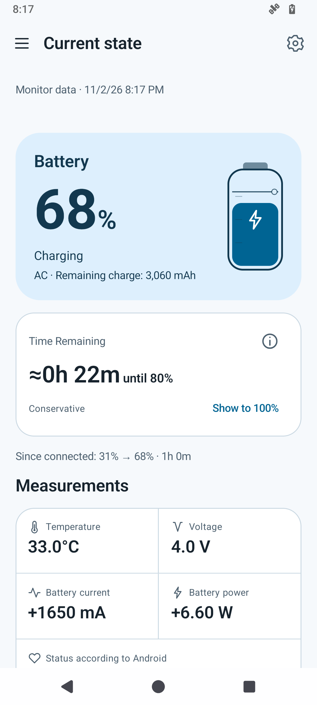
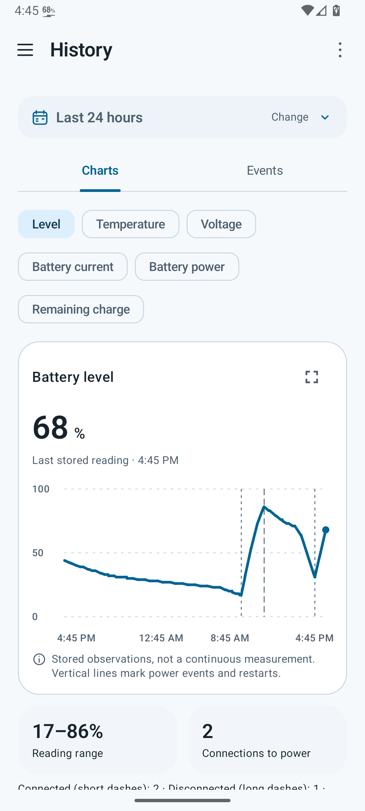
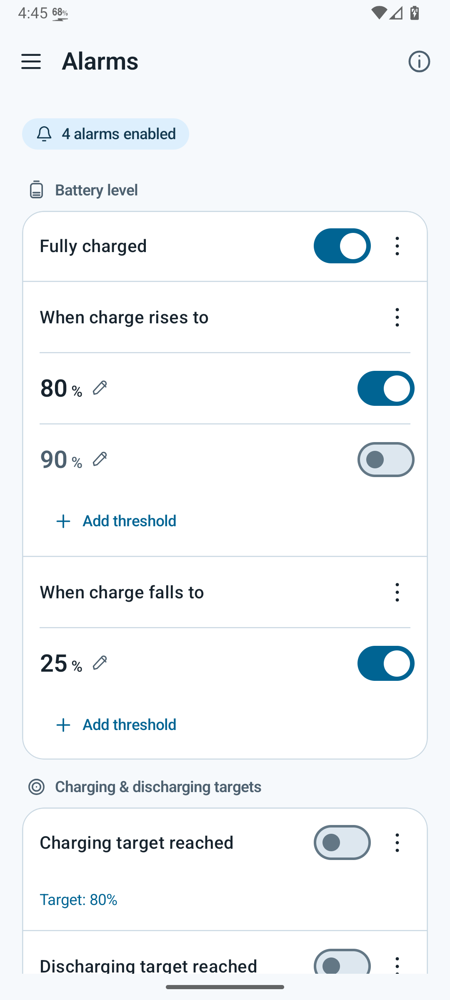
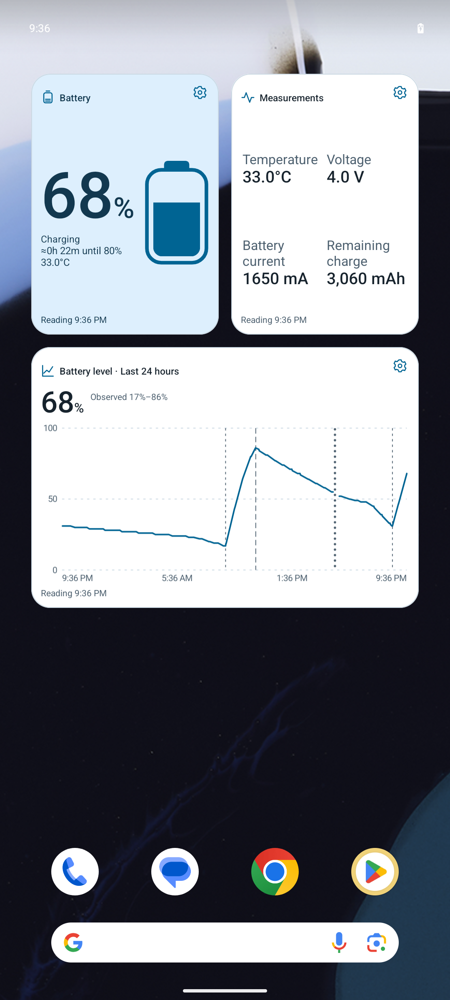

<p align="center">
  
</p>

<h1 align="center">Battery Monitor</h1>

<div align="center">
  
[](https://github.com/tswistak/Battery-Monitor/releases/latest)
[](https://f-droid.org/packages/codes.swistak.batterymonitor/)

</div>

Battery Monitor is a practical Android app for checking battery status, following battery history and setting battery alarms.

See current readings and time estimates, review charging and discharging over time, and keep battery information visible in notifications and widgets.

<p align="center">
  
  
  
  
</p>

## Highlights

- Current battery readings and approximate charging/discharging time estimates
- Interactive measurement history and fullscreen comparison of two metrics
- Configurable battery alarms with multiple thresholds
- Persistent notification and Live Updates on supported Android 16+ devices
- Configurable home screen widgets
- CSV/JSON history export and backup/restore
- Optional advanced information through root or Shizuku
- Local processing of monitoring data

## Features

### Current State and Time Estimates

- Battery level, charging status and power source, temperature, voltage, current and remaining charge, where available
- Battery-side power calculated from voltage and current
- Approximate charging/discharging estimates with configurable targets and an alternative full-range estimate where applicable
- A recent battery-level trend

Readings depend on the device and the data Android makes available. Android-reported battery health is a status, not a capacity-health percentage or a measurement of degradation.

### History and Logs

- Battery events and periodic measurements
- Charts for level, temperature, voltage, current, power and remaining charge
- Time ranges, event filtering, interactive charts and a fullscreen view comparing up to two metrics
- CSV/JSON export and import, with choices to add imported history or replace existing history
- CSV/JSON export for a selected range, everything, or logs since the last manual export, including append to a compatible existing file; automatic CSV/JSON exports to a chosen folder, as new files or appended to an existing file

### Main Notification

- Persistent battery information with configurable content and expanded details
- Optional Live Updates on Android 16+ with compatible system behavior and settings

Notification presentation, including status bar indicators, depends on Android and the device.

### Battery Alarms

- Full-charge alarms and rising/falling battery-level thresholds
- High/low temperature and Android-reported health alarms
- Charging/discharging target alarms
- Multiple thresholds for threshold-based alarm types

Targets support estimates and alarms; Battery Monitor does not set a hardware charging cutoff. Alarm sounds and notification channels are configured through Android settings.

### Widgets

- Status, Measurements and Trend widgets with per-widget appearance and content settings
- Classic Circle and Full variants remain available
- Add and configure widgets through your launcher's widget workflow

### Backup and Restore

- General backups include settings, alarms, history and predictor data
- Save backups to user-selected files and choose which categories to restore
- Add restored history to existing records or replace them

### Appearance and Advanced Information

- Light, dark and true-black appearance, with dynamic colors on supported devices
- Optional additional readings through root or Shizuku, plus diagnostic information

Requires Android 8.0/API 26 or newer. Optional readings, manufacturer-specific charging-limit detection and Live Updates depend on the device and Android version. Root and Shizuku are not required for ordinary monitoring.

## Privacy

Battery and device information is processed locally. Device-provided fields can include identifiers such as a battery serial number, where available. Battery Monitor does not send monitoring data to external servers. Files you export or share may contain device information.

## Project Background

This project is a fork of [Battery Indicator Pro / BatteryBot Pro](https://github.com/darshan-/Battery-Indicator-Pro), with continued development and rebranding.

The goal of the fork is to maintain and enhance battery monitoring for modern Android versions. Check [CHANGELOG](CHANGELOG.md) for details on changes and updates.

Thanks to the original authors and contributors.

## Development

Use Android Studio for development.

### Build

```bash
./gradlew assembleDebug
```

### Tests

JVM tests protect decision logic and backup/migration compatibility. Run them without an emulator:

```sh
./gradlew :app:testDebugUnitTest
```

Ordinary instrumented tests protect real Android storage and UI behavior. With a dedicated Android runtime running:

```sh
./gradlew :app:connectedDebugAndroidTest
```

Use JDK 21. The instrumented command uses AndroidJUnitRunner and excludes the separate Appium E2E suite. JVM reports are under `app/build/reports/tests/`; Android reports are under `app/build/reports/androidTests/`.

[E2E test guide](E2E.md) covers emulator setup, fresh-build execution, fixture inputs, reports and GitHub Actions.

[Profiling guide](profiling.md) covers isolated profiling builds, benchmark execution, supporting traces and local analysis.

## License

GNU GPL v3.0-or-later.  
See [LICENSE](LICENSE).

## Release signing

GitHub APK releases since version 1.7.0 are signed with OpenPGP.

Fingerprint:
4A5C 1BDE 7687 85AD 68F2  C4F0 99B6 89A2 66FF 1B8B

Public key:
[docs/release-signing-key.asc](https://raw.githubusercontent.com/tswistak/Battery-Monitor/refs/heads/master/docs/release-signing-key.asc).
